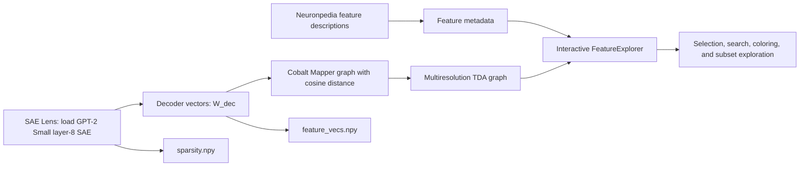

# Topological Data Analysis and Mechanistic Interpretability — SAE Lens v6 fix

This repository preserves a compatibility-fixed version of the Colab notebook associated with the LessWrong post [“Topological Data Analysis and Mechanistic Interpretability”](https://www.lesswrong.com/posts/6oF6pRr2FgjTmiHus/topological-data-analysis-and-mechanistic-interpretability). It keeps the original notebook methodology while updating the SAE loading call for SAE Lens v6.

[](https://colab.research.google.com/github/BurnyCoder/topological-data-analysis-mechanistic-interpretability-fix/blob/main/Exploring_SAE_features_with_TDA_graphs.ipynb)

## Methodology and data flow

The notebook loads a 32k-feature TopK sparse autoencoder trained on the layer-8 residual stream of GPT-2 Small: OpenAI's v5 SAE with 32,768 features and k = 32, as repackaged for SAE Lens in [jbloom/GPT2-Small-OAI-v5-32k-resid-post-SAEs](https://huggingface.co/jbloom/GPT2-Small-OAI-v5-32k-resid-post-SAEs) (see `v5_32k_layer_8.pt/cfg.json`). It uses the SAE decoder vectors as feature representations, builds multiresolution Mapper graphs with cosine distance, and combines those graphs with Neuronpedia feature descriptions in an interactive explorer. It also demonstrates coloring by feature sparsity (the SAE Lens log activation-frequency tensor) and rebuilding the graph for the most frequently active 10% of features.



## Compatibility change

SAE Lens v6 changed `SAE.from_pretrained()` to return only the SAE object ([migration guide](https://github.com/decoderesearch/SAELens/blob/main/docs/migrating.md)). Legacy tuple unpacking still runs with a `DeprecationWarning`, but in SAE Lens 6.47.0 it yields `None` in place of the sparsity tensor (`SAE.__iter__` in [`sae.py`](https://github.com/decoderesearch/SAELens/blob/v6.47.0/sae_lens/saes/sae.py)). Later cells call `sparsity.numpy()`, so the notebook needs the tuple-returning loader. Its single source-code change is:

```python
# Original SAE Lens <=5 call
sae, cfg_dict, sparsity = sae_lens.SAE.from_pretrained(...)

# SAE Lens v6-compatible call
sae, cfg_dict, sparsity = sae_lens.SAE.from_pretrained_with_cfg_and_sparsity(...)
```

The new tuple-returning loader is defined in the [SAE Lens source](https://github.com/decoderesearch/SAELens/blob/main/sae_lens/saes/sae.py). All other notebook source cells match the upstream Colab notebook.

## Run the notebook

### Google Colab

Use the badge above, then run the cells in order. The notebook installs its packages, downloads the SAE and public Neuronpedia descriptions, constructs the graphs, and displays the interactive explorer. Internet access and enough memory for the 32k-feature graph are required.

### Local JupyterLab with uv

Python 3.12 and a resolved dependency set are locked in `uv.lock`. The direct dependencies in `pyproject.toml` are pinned to the versions shown in the preserved Colab run's `pip` output, except `jupyterlab`, which that run did not use. Many transitive versions differ from the run: 53 of the 176 packages listed in both differ, for example `torch` 2.13.0 in the lock versus 2.11.0+cpu in the run. The locked environment has been import-tested only. The full notebook has not been run in it.

```bash
git clone https://github.com/BurnyCoder/topological-data-analysis-mechanistic-interpretability-fix.git
cd topological-data-analysis-mechanistic-interpretability-fix
uv sync
uv run jupyter lab
```

Cobalt requires separate registration under its own license. Follow the [official Cobalt setup instructions](https://docs.cobalt.bluelightai.com/setup.html). You can register interactively, or copy `.env.example` to `.env`, add `COBALT_LICENSE_KEY`, and launch with:

```bash
uv run --env-file .env jupyter lab
```

Never commit `.env`; it is ignored by Git.

## Repository artifacts

| Artifact | Purpose |
| --- | --- |
| `Exploring_SAE_features_with_TDA_graphs.ipynb` | Canonical small notebook for reading, diffing, and running. |
| `artifacts/Exploring_SAE_features_with_TDA_graphs.executed.ipynb` | Preserved 98.9 MiB successful Colab execution, including widget state and outputs. |

The executed snapshot is stored with Git LFS. Run `git lfs pull` after cloning if it was not downloaded automatically. GitHub may not preview such a large notebook; use the canonical notebook for browsing.

Running the notebook writes `explanations.json`, `feature_vecs.npy`, and `sparsity.npy` in the working directory. These reproducible outputs are intentionally ignored rather than committed.

## Validation and provenance

The preserved execution ran all 19 code cells in order (execution counts 13 to 30) without an error output. The `pip` output of its first code cell shows Python 3.12, SAE Lens 6.47.0, Cobalt 0.4.2, and TransformerLens 3.6.0. Its `language_info` metadata says Python 3.12.8, but that field is identical to the upstream notebook's, whose own outputs were produced under Python 3.11, so it does not establish the patch version. Structural, dependency, size, LFS, and credential checks are recorded in the [validation report](reports/2026-08-03-validation.md).

The notebook was linked by Jakob Hansen in the discussion below Gunnar Carlsson’s LessWrong post. Exact upstream links, hashes, attribution details, and the modification boundary are documented in [provenance](docs/provenance.md).

No repository-level license is asserted over the upstream notebook because the upstream artifact does not state one. Dependencies, including Cobalt, remain subject to their own licenses.
